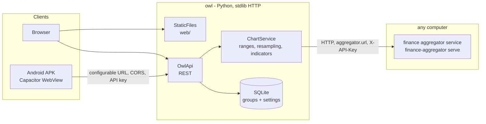

# Owl - stock viewer

Owl is a web-based stock viewer that consumes the [finance aggregator](../../data-providers/finance-aggregator/README.md).
All stock data comes from the **aggregator service** over HTTP (`aggregator.url`), on this PC or on another
computer. Owl never contacts a data source (yahoo-db, Yahoo Finance) itself; the aggregator decides where
data comes from and falls back between its providers.
It looks like VS Code (Dark+ workbench) and draws its charts in the TradingView style, using
TradingView Lightweight Charts. Because it is a web app, it runs in any browser, as a standalone
executable on Windows and Linux, and as an Android APK (a Capacitor wrapper around the same UI).

## Features

| Area | What you get |
|------|--------------|
| **Watchlist** | Groups shown as folders in the Explorer, with symbols inside. You can create, rename and delete groups, and add or remove symbols. Symbols are validated against the aggregator and company names are shown next to them. The same symbol can be in several groups. Every symbol shows its **last price and day change** (green/red). Each group row shows a **summary**: how many of its symbols are up ▲ and down ▼ today, and their average day change (equal-weighted). Hover it for the best and worst symbol. Prices refresh every 60 s; the server caches them and prefetches them at startup |
| **Drag and drop** | Drag a symbol onto another group to **move** it, or **Ctrl+drag** (Alt on macOS) to **copy** it. Dropping onto a symbol inserts it before that one, which also reorders symbols within a group. On touch screens, where dragging isn't available, the **Move to group…** row action does the same |
| **Interactive search** | **Ctrl+P** (Go to symbol) and **Add symbol** suggest matches as you type, by ticker *or* company name (`nvid`, `apple`, `berkshire`). **Add symbol** asks for the stock first and only then for the group (skipped when there is a single group or when started from a group's **+** button); groups that already contain the stock are marked. Each match shows the symbol, the company name with the typed text highlighted, the exchange and type (Stock, ETF, Index, Future, ...), and which watchlist groups already contain it ("already in this group" when adding). Watchlist symbols appear instantly, and data-provider results follow after a 200 ms debounce. Arrow keys move through the list. Enter takes the highlighted match; pressed while results are still loading, it waits for them. A typed ticker that isn't listed is still accepted |
| **Ranges** | 1D · 1W · 1M · 3M · 6M · 1Y · 2Y · 5Y · ALL |
| **Candle interval** | Auto (daily up to 2Y, weekly for 5Y, monthly for ALL) or forced D / W / M |
| **Indicators** | MA 20 / MA 50 / MA 200 presets, plus custom SMA/EMA with any period (1-1000, up to 10). Settings are saved on the server, so desktop and phone share them. MAs are computed with enough extra history (warm-up) that they are valid from the first visible bar |
| **Drawings** | The chart toolbar has **Line**, **Arrow** and **Comment**. For a line or an arrow, click the start and then the end point (the arrowhead goes at the end); Esc cancels. For a **comment**, click the point it refers to and type the text (up to 500 characters): a speech bubble appears with its tail pointing to that point. Click a drawing to select it (handles appear). Drag a line or arrow to **move** it, or drag an end to **stretch / turn** it. Drag a comment's bubble to move it while its tip stays on the point, or drag the tip to point elsewhere. **Double-click** a comment (or press Enter / F2 while it is selected) to **edit** its text. The chart doesn't pan while you drag. **Delete** (or the trash button) removes the selected drawing, and the clear button removes all drawings of the symbol. Points are anchored to a date and a price, so drawings stay in place when you zoom, scroll, or switch D / W / M. They can also extend past the last bar. Drawings are saved per symbol on the server (`/api/settings/drawings`, at most 100 per symbol) and shared across devices |
| **Chart** | Candles and indicator lines, with **volume as bars in a resizable pane at the bottom**. Mouse-wheel / pinch zoom and drag to scroll, plus zoom in, zoom out and reset buttons. A crosshair legend shows OHLC, change, volume, MA values and the **data provider of the bar** |
| **Market status** | The title bar shows whether the US stock market (NYSE / Nasdaq) is **open** (green), in **pre-market** (04:00-09:30 ET) or **after hours** (16:00-20:00 ET) (amber), or **closed** (red, with the holiday name), plus a countdown to the next open or close. The tooltip gives the time in New York and in your own time zone. It is computed in the browser in New York time (`web/js/market.js`), including NYSE holidays (with weekend shifts) and the 13:00 early closes, so it needs no server or network. It can be turned off in Settings |
| **VS Code look** | Activity bar, Explorer tree, editor tabs (one per symbol, middle-click closes), breadcrumbs, a command-palette style quick input (**Ctrl+P** opens Go to symbol), notifications, and a status bar showing aggregator health and price bars per provider |
| **Settings** | **Ctrl+,** or the gear icon opens a VS Code-style **Settings** tab. It has a search box and sections, shows a reset button next to each changed setting, and validates input (e.g. a value outside the allowed range is rejected with a message). Settings: **Explorer position** (left / **right**, the default; on phones the drawer slides in from that side), Explorer width (also set by dragging its edge), show prices, show day change, price refresh interval (15-3600 s), reset indicators, owl server connection and data provider status. They apply at once and are saved on the server (`/api/settings/ui`), so all devices share them; a local copy applies them instantly at startup. The connection is the exception: it is stored per device |
| **Mobile** | Below 768 px the sidebar becomes a drawer (☰), rows get touch-sized, and the toolbar scrolls horizontally |
| **Connection status** | The status bar always shows the data provider state: *online*, *degraded* (amber, with the list of providers that are down), *data provider unavailable*, *owl server offline*, or *unauthorized*. When data can't be loaded, a red banner explains why, shows a reconnect countdown, and offers **Retry now** and **Details** (each provider's state in fallback order). Owl reconnects automatically: it checks every 30 s while healthy, and after a failure retries with backoff (3 → 5 → 10 → 15 s). It also checks immediately when a request fails, when the network comes back, or when the app returns to the foreground. On recovery a notification appears and the open chart and watchlist reload by themselves. The server caches provider status for 5 s (`/api/status?refresh=1` bypasses the cache), so many clients don't hammer the providers |

## Architecture



Stock splits are handled where the data is stored (yahoo-db re-downloads a ticker's history after a split),
so owl shows the bars exactly as the aggregator delivers them.

| Module | Responsibility |
|--------|----------------|
| `owl/market_data.py` | Owl's only link to market data: `RemoteAggregatorSource` calls the aggregator's `serve` HTTP API and implements the aggregator contract (`StockDataSource` + `FinanceService`). Owl imports only the aggregator's data contracts (`finance_aggregator.core`, standard library only), not its providers |
| `owl/charts.py` | `ChartRange`, `Interval` (daily → weekly/monthly resampling, which keeps the mixed provider tags), and the `Indicator` registry (`SimpleMovingAverage`, `ExponentialMovingAverage`). `ChartService` works out the fetch window (range + indicator warm-up, at least 400 days for daily charts) and builds the payload |
| `owl/watchlist.py` | `WatchlistRepository` interface, with `SqliteWatchlistRepository` as the implementation (groups, items, settings) |
| `owl/server.py` | Router, `OwlApi` (transport independent), `StaticFiles` (path-traversal safe, ETag), and the HTTP handler (CORS, API key, JSON-only writes, body size limit, security headers / CSP) |
| `owl/app.py` | Composition root (`OwlApplication`) and the command line |
| `web/` | No-build ES modules: `api.js` (REST client), `ui.js` (DOM helpers, quick input, notifications), `explorer.js`, `chart.js` (Lightweight Charts wrapper), `settings.js` (settings store and Settings tab), `drawings.js` (lines, arrows and comment bubbles, drawn as a Lightweight Charts series primitive), `app.js` (workbench wiring and the settings schema). Vendored libraries are in `web/vendor/` (licenses included) |

**Data provenance.** The aggregator tags every price bar with the provider that supplied it, and
owl passes that tag all the way to the UI: the crosshair legend shows the source of the hovered
bar, and the status bar shows bars per provider. For example, `yahoo-db-api 444 · yahoo-finance 8`
means yahoo-db was stale and its tail was filled from Yahoo Finance.

### Adding an indicator

Subclass `Indicator` in `owl/charts.py`, implement `compute(closes)`, and register it in
`INDICATORS`. The REST API accepts the new type at once (`indicators=rsi:14`). For the UI, add
the type to `INDICATOR_RE` in `web/js/app.js`.

### Adding a setting

Add one entry to `settingsSchema()` in `web/js/app.js`:
`{key, section, title, description, type, default}`. `type` is `enum` (with `options`), `boolean`,
`number` (with `min`, `max`, `unit`), or `action` (a button with `run()`). Then read the value with
`this.settings.get(key)` and apply it in `applySettings()`. The Settings tab, validation, reset,
local caching and server storage come from `web/js/settings.js`; no server change is needed.

## REST API

All responses have the shape `{"status": "success", "data": ...}` or `{"status": "error", "error": "..."}`.

| Method | Endpoint | Description |
|--------|----------|-------------|
| GET | `/api/health` | Liveness check (no API key needed) |
| GET | `/api/status` | Owl version plus aggregator/provider status |
| GET | `/api/groups` | Groups with their symbols |
| POST | `/api/groups` `{"name"}` | Create a group |
| PATCH | `/api/groups/{id}` `{"name"}` | Rename a group |
| DELETE | `/api/groups/{id}` | Delete a group |
| POST | `/api/groups/{id}/items` `{"symbol"}` | Add a symbol (validated through the aggregator) |
| DELETE | `/api/groups/{id}/items/{symbol}` | Remove a symbol |
| POST | `/api/groups/{id}/items/{symbol}/move` `{"to", "copy"?, "before"?}` | Move (or copy) a symbol to group `to`, before symbol `before` (default: at the end). With `to` = the same group it reorders. Returns all groups |
| GET | `/api/quotes?symbols=AAPL,MSFT` | Last close, previous close and change per symbol (`null` when there is no data). Cached for 60 s, at most 200 symbols |
| GET | `/api/ticker/{symbol}` | Ticker information |
| GET | `/api/search?q=QUERY[&limit=N]` | Type-ahead symbol search through the aggregator (ticker or company name). Each match also lists the watchlist `groups` that contain it |
| GET | `/api/chart/{symbol}?range=6M&interval=D&indicators=sma:20,ema:9` | Bars (with `source`), indicator series, quote, `visible_from`, `sources` |
| GET/PUT | `/api/settings/chart` | Indicator settings (shared across devices) |
| GET/PUT | `/api/settings/drawings` | Drawings per symbol: `{"AAPL": [{"id", "type": "line" \| "arrow" \| "note", "a": {"day", "price"}, "b": {...}, "text"}]}` (`day` = days since 1970-01-01, fractional; a note's `a` is the point it refers to, `b` the bubble centre, `text` its comment; no `type` = line) |
| GET/PUT | `/api/settings/ui` | GUI settings of the Settings tab, as `{"<key>": value}` (only values that differ from the default) |

Status codes: 400 invalid input, 401 API key, 404 not found, 409 conflict, 415 non-JSON write,
502 provider error, 503 provider unavailable.

## Configuration (`config.json`)

| Key | Default | Description |
|-----|---------|-------------|
| `aggregator.url` | `http://127.0.0.1:5100` | Address of the finance aggregator service (`finance-aggregator serve`). Can be another computer, e.g. `http://192.168.1.20:5100` |
| `aggregator.api_key` | `null` | Sent as `X-API-Key`; must match the aggregator's `server.api_key` (required when the aggregator listens on the network) |
| `aggregator.timeout_seconds` | `30` | Timeout per request to the aggregator |
| `server.host` / `port` | `127.0.0.1` / `8710` | Listen address |
| `server.api_key` | `null` | When set, every `/api/*` call except health needs `X-API-Key`. Can also be set with the env var `OWL_API_KEY` |
| `server.cors_origins` | `http://localhost`, `https://localhost`, `capacitor://localhost` | Origins allowed to call the API cross-origin (the Android app). `*` is rejected |
| `server.open_browser` | `true` | Open the UI when the server starts |
| `server.allow_insecure_remote` | `false` | Owl **refuses** to listen on a non-loopback address without an API key unless this is `true` |
| `browser.chrome` | `local` | Which Chrome opens the UI. `local`: the Chrome shipped in the repo (`browser.chrome_dir`), with a private profile, closed again when owl stops. `installed`: the Chrome installed on the PC, with the user's own profile. A missing local Chrome falls back to the installed one, and a missing Chrome to the default browser |
| `browser.chrome_dir` | `../../common/chrome` | Folder with the local `chrome.exe` (Windows build; on Linux the installed Chrome is used) |
| `browser.app_window` | `true` | Open as an app window (`--app`, no tabs or address bar) instead of a normal tab |
| `browser.exit_on_close` | `true` | Closing the local Chrome window stops owl. The local Chrome also ends with owl, even when owl is killed. This doesn't apply to the installed Chrome or the default browser, because owl can't tell when those windows close |
| `browser.profile_dir` | `null` | Profile of the local Chrome. Default `%LOCALAPPDATA%\owl\chrome-profile` (Linux: `~/.local/share/owl/chrome-profile`) |
| `storage.database` | `./data/owl.db` | Watchlist and settings |
| `web.root` | `null` | Override the UI folder (default: `web/`, or the copy bundled in the executable) |
| `logging.*` | | Same keys as the aggregator (`level`, `file`, `max_bytes`, `backup_count`) |

Override the config path with `--config <path>` or the env var `OWL_CONFIG`. Command line
options: `--host`, `--port`, `--no-browser`, `--log-level`, `--version`.

### Connecting to the aggregator

Owl needs a running aggregator. Its `run.cmd` / `run.sh` opens the aggregator's interactive CLI and serves
the HTTP API Owl uses at the same time. On the same PC:

```bat
..\..\data-providers\finance-aggregator\run.cmd      :: CLI + HTTP API on http://127.0.0.1:5100 (Linux: run.sh)
```

On another computer, let the aggregator listen on the network with an API key (in its `config.json`:
`"server": {"host": "0.0.0.0", "port": 5100, "api_key": "<long random string>"}`) and point owl at it:

```json
"aggregator": {"url": "http://192.168.1.20:5100", "api_key": "<the same key>", "timeout_seconds": 30}
```

When the aggregator can't be reached, owl keeps running: the status bar shows *data provider unavailable*
and owl reconnects automatically once the aggregator is back.

## Run, build and dependencies

The run scripts share the aggregator's environment tooling: venv creation, detection and repair
of a moved venv, the `get-pip` fallback on Ubuntu, and the requirement/version check with a hash
stamp. Owl needs only the Python standard library at runtime (its `requirements.txt` is empty); the
aggregator's data contracts are imported from its sources (`OWL_AGGREGATOR_DIR`).

| | Windows | Linux |
|--|---------|-------|
| Run from source | `run.cmd [--no-browser]` | `./run.sh [--no-browser]` |
| Prepare the environment only | `run.cmd --setup-only` | `./run.sh --setup-only` |
| Standalone executable | `build.cmd [--skip-tests]` → `dist\windows\owl.exe` | `./build.sh [--skip-tests]` → `dist/linux/owl` |
| Virtual environment | `.venv-windows` (from `FINANCE_PYTHON`, otherwise the shared `python\3.14`) | `.venv-linux` (`python3`) |

Environment overrides: `OWL_VENV`, `OWL_AGGREGATOR_DIR`, `FINANCE_PYTHON`. On WSL with the
checkout on `/mnt/c`, put the venv on the Linux file system, e.g.
`OWL_VENV=$HOME/.venvs/owl ./build.sh`.

Each executable bundles the web UI and the aggregator's data contracts (no data providers). The
build writes `config.json` next to the executable; an existing one is kept, and settings of the
removed embedded aggregator (`aggregator.mode`, `aggregator.config_file`, `splits`) are dropped from it.
Owl stores its data in `data/owl.db` next to the config.
`owl.exe` has no terminal window. The UI is the Chrome window, and closing it stops owl
(`browser.exit_on_close`). Startup errors, such as a bad config or a port in use, appear in a
message box and in `logs/owl.log`. Starting owl again while it runs just opens a window on the
running instance.
The local Chrome (~376 MB) is not bundled: the generated `config.json` points `browser.chrome_dir`
at the repo's `common/chrome`. To ship the executable elsewhere, copy that folder next to it and
set `"chrome_dir": "chrome"`.

## Android APK

`mobile/` is a Capacitor 8 project that packages `web/` into an Android app. The phone does not
run Python, so the app talks to an owl server over the network.

1. Install the build prerequisites: Node.js 20+, JDK 21, and the Android SDK (Android Studio, or
   the command line tools with `platforms;android-36` and `build-tools`). Set `ANDROID_HOME`.
2. Build:
   - Windows: `build-apk.cmd` → `dist\android\owl-debug.apk`
   - Linux: `./build-apk.sh`
   - Add `release` for an unsigned release APK, then sign it with `apksigner`.
3. Run an owl server the phone can reach:
   ```json
   "server": {"host": "0.0.0.0", "port": 8710, "api_key": "<long random string>"}
   ```
4. Install the APK. On first start the app asks for the server URL (e.g.
   `http://192.168.1.20:8710`) and the API key. You can change them later in Settings (gear
   icon) → Connection → Owl Server.

The app's origin is `http://localhost`, which is already in `cors_origins`, and plain-HTTP
requests to the LAN server are allowed (`server.cleartext`). For access over the internet, put
owl behind HTTPS (a reverse proxy).

## Tests

```
.venv-windows\Scripts\python -m pytest
```

| Test file | What it covers |
|-----------|----------------|
| `test_charts.py` | SMA/EMA maths, indicator parsing, weekly/monthly resampling (including mixed provider tags), ranges, warm-up window, quote, 1D/ALL behaviour |
| `test_watchlist.py` | Group and item CRUD, conflicts, cascade delete, seeding exactly once, persistence, settings size limit |
| `test_server.py` | REST API status codes, no leaking of provider details, static path traversal, ETag/304, CSP, CORS allow-list, API key, JSON-only writes, body limit, refusing to bind insecurely |
| `test_market_data.py` | `RemoteAggregatorSource` against the **real aggregator HTTP server** (bar sources preserved, errors translated, unreachable server), config validation |

## Limitations and next steps

- **Daily data only.** The aggregator supplies daily bars, so 1D/1W show the most recent daily
  candles. Intraday bars (1m-1h) would need intraday support in the aggregator (Yahoo Finance
  provider) first.
- **No PWA service worker yet.** The UI needs the server to be reachable.
- The Linux daemon (`service.sh`) currently exists only for the aggregator. Owl can be run the
  same way: `owl --no-browser`.

## Third-party components

| Component | Location | License |
|-----------|----------|---------|
| TradingView Lightweight Charts™ 5.2.1 | `web/vendor/lightweight-charts/` | Apache-2.0. The TradingView attribution logo is kept on the chart, as the license notice requires |
| VS Code Codicons 0.0.36 | `web/vendor/codicons/` | CC-BY-4.0 (icons) / MIT (code), © Microsoft |
| Capacitor 8 | `mobile/` (npm) | MIT |
