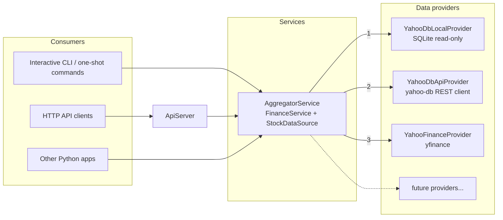

# Finance Aggregator

Unified, extensible stock data service. Consumers ask one interface for ticker information and
price history. The aggregator works out which backend can answer:

1. **yahoo-db local DB**: the yahoo-db SQLite file, if it is reachable on this machine (read-only)
2. **yahoo-db API**: the yahoo-db REST service (default `http://187.124.178.83:5000`)
3. **Yahoo Finance**: live data through `yfinance`, used as the last resort

You can use it as an interactive CLI, as one-shot commands, or as an HTTP API. On Linux the HTTP
API can run as a systemd daemon.

---

## Contents

- [Architecture](#architecture)
- [Provider model](#provider-model)
- [Fallback mechanism](#fallback-mechanism)
- [Configuration](#configuration)
- [CLI](#cli)
- [HTTP API (`serve`)](#http-api-serve)
- [Run from source](#run-from-source)
- [Build standalone executables](#build-standalone-executables)
- [Linux daemon (systemd)](#linux-daemon-systemd)
- [Implementing a new provider](#implementing-a-new-provider)
- [Adding a CLI command](#adding-a-cli-command)
- [Tests](#tests)
- [Reuse of yahoo-db](#reuse-of-yahoo-db)
- [Troubleshooting](#troubleshooting)

---

## Architecture



| Layer | Package | Responsibility |
|-------|---------|----------------|
| Core | `finance_aggregator/core` | Immutable domain models (`TickerInfo`, `PriceBar`, `PriceHistory`, `DateRange`, statuses), the error hierarchy, and the interfaces (`StockDataSource`, `DataProvider`, `FinanceService`) |
| Data providers | `finance_aggregator/providers` | One class per backend, a registry/factory keyed by the config `type`, and the yahoo-db source bridge |
| Services | `finance_aggregator/services` | `AggregatorService`: an ordered provider chain with a fallback policy |
| Consumers | `finance_aggregator/cli`, `finance_aggregator/server` | Command framework and interactive shell; read-only JSON HTTP API |
| Composition root | `finance_aggregator/app.py` | Loads config, plugins and providers, then wires the aggregator, commands and logging (dependency injection, no globals) |

Key interfaces (`core/interfaces.py`):

```python
class StockDataSource(ABC):            # what consumers depend on
    def get_ticker_info(self, symbol: str) -> TickerInfo: ...
    def get_price_history(self, symbol: str, date_range: DateRange) -> PriceHistory: ...

class DataProvider(StockDataSource):   # one backend
    kind: ClassVar[str]                # config "type"
    def is_available(self) -> bool     # cheap pre-check, no network
    def check_status(self) -> ProviderStatus
    # subclasses implement: _fetch_ticker_info, _fetch_price_history, _probe

class FinanceService(ABC):             # long-lived services (aggregation, analysis, ...)
    def check_status(self) -> ServiceStatus
```

`AggregatorService` implements both `FinanceService` and `StockDataSource` (composite pattern).
Consumers therefore cannot tell whether they hold one provider or a whole chain. Every result has a
`source` field that names the provider that answered. Each price bar also carries its own
`source`, because one history can combine several providers (see
[Fallback mechanism](#fallback-mechanism)). These fields are there for transparency; consumers
never need to branch on them.

### Error contract

| Exception | Meaning | CLI exit code | HTTP status |
|-----------|---------|---------------|-------------|
| `InvalidRequestError` | Bad symbol or date range; rejected before any provider is called | 2 | 400 |
| `DataNotFoundError` | The data does not exist in any source that could answer | 3 | 404 |
| `ProviderUnavailableError` | No source could answer (offline, missing file, rate-limited) | 4 | 503 |
| `ProviderError` | A source answered with an error (bad payload, schema mismatch, HTTP 500) | 1 | 502 |

`ProviderUnavailableError` is a subclass of `ProviderError`. A `DataNotFoundError` raised by the
aggregator lists every provider attempt. Its `unchecked_providers` property names the sources that
were unreachable, so a "not found" result that may be incomplete is still visible.

## Provider model

| Type (`config.json`) | Class | Source | Not found | Unavailable / error |
|----------------------|-------|--------|-----------|---------------------|
| `yahoo_db_local` | `YahooDbLocalProvider` | yahoo-db SQLite file, opened read-only (`?mode=ro` URI), so it never writes to or locks out the yahoo-db writer | No row in `tickers` / no rows in `historical_data` | File missing, locked or busy → unavailable. Not a yahoo-db schema → error |
| `yahoo_db_api` | `YahooDbApiProvider` | yahoo-db's own `YahooDB` client (`yahoodb-api.py`) | HTTP 404 or empty history | Connection failure, 408/429/502/503/504 → unavailable. Other HTTP errors → error |
| `yahoo_finance` | `YahooFinanceProvider` | `yfinance` with exceptions enabled | `YFTickerMissingError`, HTTP 404, empty info or empty frame | Network `OSError`, rate limit, 401/403/429/5xx → unavailable. Other `YFException` → error |

All providers return data in the yahoo-db shape and with yahoo-db semantics: `close` is the
auto-adjusted close and `adj_close == close`. The data is the same whichever backend answers.

## Fallback mechanism

For every request, `AggregatorService` does the following:

1. Validates the symbol and date range. Invalid input raises `InvalidRequestError` before any
   provider is called.
2. Walks the providers in **configuration order** (the order of the `providers` list).
3. Skips a provider whose `is_available()` returns `False`. For example, the local DB file does
   not exist.
4. Calls the provider and handles the outcome:
   - success → returns the result immediately; later providers are not called
   - `DataNotFoundError`, `ProviderUnavailableError`, `ProviderError`, or any unexpected
     exception → records the attempt and moves on to the next provider
5. **Price history merging (gap filling).** Suppose a provider's history is missing more than
   `aggregator.history_max_staleness_days` trading days (Mon-Fri) before the requested end date,
   for example because yahoo-db has not synced the latest day yet. With the default `0`, a single
   missing trading day is enough. Its bars are **kept**, and only the missing
   tail (the day after its last bar through the requested end) is requested from the next
   provider. Bars from a higher-priority provider are never overwritten. This repeats down the
   chain until the history is fresh or the chain ends; whatever was collected is then returned.
   - Every bar is tagged with the provider that supplied it: `PriceBar.source`, the `Source`
     column in the CLI, and the bar's `source` in JSON.
   - The history's `source` lists the contributing providers, e.g. `yahoo-db-api+yahoo-finance`.
   - `sources` gives the number of bars per provider.
   - Set the option to `null` to disable gap filling; the first provider with data then wins.

   ```text
   AAPL 2026-10-22..2026-11-10: 13 bars, sources: yahoo-db-api (5 bars), yahoo-finance (8 bars)
   Date        ...  Close   Source
   2026-10-28  ...  343.83  yahoo-db-api
   2026-10-29  ...  348.91  yahoo-finance
   ```
6. If nobody returned data:
   - at least one provider answered "not found" → `DataNotFoundError`
   - otherwise → `ProviderUnavailableError`

Each attempt is logged with its outcome and latency. When fallbacks happen, the whole chain is
logged too, for example:
`yahoo-db-local: unavailable (...) -> yahoo-db-api: not_found (...) -> yahoo-finance: success`.

### Symbol search (type-ahead)

Search works differently from data retrieval. Instead of the first provider winning, every
provider with `supports_search` is asked **in parallel**, each with a time limit (8 s). Their
results are then **merged**:

| Provider | Matches on | Notes |
|----------|------------|-------|
| `yahoo_db_local` | Symbol and company name of the tickers in the database | SQL `LIKE` ranking, escaped |
| `yahoo_db_api` | yahoo-db `GET /api/search` (symbol + name) | Older yahoo-db servers without the endpoint answer 404. The provider remembers that for 10 min and falls back to a symbol-only match over `GET /api/tickers` (cached for 1 h) |
| `yahoo_finance` | Yahoo's own search (`yf.Search`) | Any symbol or company worldwide, including ETFs, indices, futures and foreign listings |

The merge removes duplicates by symbol, fills in missing name, exchange and type from the other
providers, and joins the sources with `+` (for example `yahoo-db-api+yahoo-finance`). It then
ranks the results by relevance:

| Match | Score |
|-------|-------|
| Exact symbol | 100 |
| Symbol prefix | ~90 |
| Name prefix | 75 |
| Name word prefix | 65 |
| Symbol contains | 50 |
| Name contains | 45 |
| Fuzzy hit from Yahoo | 20 |

Futures, FX and crypto (`=`) lose 20 points, and foreign listings (`.`) lose 5, so the primary
listing comes first. A query must be 1-64 characters of letters, digits, spaces or `.&'-^=,/()+`.
If no provider answers at all, the search raises `ProviderUnavailableError`.

## Configuration

`config.json` sits next to `main.py` or next to the executable. Override it with
`--config <path>` or the `FINANCE_AGGREGATOR_CONFIG` environment variable. Relative paths are
resolved against the directory of the config file.

```jsonc
{
  "providers": [                                   // priority order = list order
    {"type": "yahoo_db_local", "name": "yahoo-db-local", "enabled": true,
     "options": {"db_path": "../data/stocks.db", "timeout_seconds": 5}},
    {"type": "yahoo_db_api", "name": "yahoo-db-api", "enabled": true,
     "options": {"host": "187.124.178.83", "port": 5000, "timeout_seconds": 10,
                 "client_source_dir": "../yahoo-db"}},
    {"type": "yahoo_finance", "name": "yahoo-finance", "enabled": true,
     "options": {"timeout_seconds": 15, "cache_dir": "./cache/yfinance",
                 "probe_symbol": "SPY", "proxy": null}}
  ],
  "aggregator": {"history_max_staleness_days": 0}, // missing trading days tolerated; null disables gap filling
  "server":     {"host": "127.0.0.1", "port": 5100, "api_key": null, "auto_start": true},
  "logging":    {"level": "INFO", "file": "./logs/finance-aggregator.log",
                 "max_bytes": 5242880, "backup_count": 5},
  "plugins":    []                                 // extra modules that register providers
}
```

| Key | Description |
|-----|-------------|
| `providers[].type` | Registry key of the provider class |
| `providers[].name` | Unique display name, also used as the result `source` |
| `providers[].enabled` | `false` removes the provider from the chain without deleting its config |
| `yahoo_db_local.db_path` | Path to the yahoo-db `stocks.db` |
| `yahoo_db_api.host` / `port` / `timeout_seconds` | Location of the yahoo-db REST API |
| `yahoo_db_api.client_source_dir` | yahoo-db folder that contains `yahoodb-api.py`. Executables fall back to their bundled copy |
| `yahoo_finance.cache_dir` | yfinance cache location (kept inside the install folder so the daemon can write to it) |
| `yahoo_finance.proxy` | Optional HTTP(S) proxy URL for Yahoo |
| `server.api_key` | When set, every endpoint except `/api/health` requires the header `X-API-Key`. The key can also be supplied through the env var `FINANCE_AGGREGATOR_API_KEY` |
| `server.auto_start` | `true` (default): the interactive CLI also serves the HTTP API in the background. `false`: only on `server start` |

If a provider cannot be constructed (unknown type, missing yahoo-db sources, bad option), it is
replaced by a `MisconfiguredProvider` placeholder. The rest of the chain keeps working, and
`status` shows the reason.

## CLI

```text
finance-aggregator [--config PATH] [--log-level LEVEL] [--version] [command ...]
```

With no command, an interactive shell starts (`finance> `) and the HTTP API is served in the
background (see [HTTP API](#http-api-serve)). With a command, that single command
runs and the exit code reflects the result (see [Error contract](#error-contract)).

| Command | Description |
|---------|-------------|
| `status [--json]` | Aggregator state plus each provider's state, latency and detail, in priority order |
| `read SYMBOL [--info \| --history] [--days N \| --months N \| --years N \| --start DATE [--end DATE]] [--limit N] [--json]` | Ticker information and price history. Default: both, last 30 days. `--limit` caps the printed rows (default 25, 0 = all) |
| `search QUERY... [--limit N] [--json]` / `find` | Finds symbols by ticker or company name (`search apple`, `search berkshire hath`). Default 10 results, max 50 |
| `serve [--host H] [--port P]` | Runs the HTTP API in the foreground (Ctrl+C or SIGTERM stops it) |
| `server [status \| start \| stop]` / `api` | Interactive shell only: shows, starts or stops the HTTP API that runs next to the shell |
| `help [command]` / `?` | Command list or detailed help for one command (`<command> --help` also works) |
| `exit` / `quit` / `q` | Leaves the shell (Ctrl+D / Ctrl+Z also exits) |

Examples:

```text
finance> status
finance> read AAPL
finance> read MSFT --history --start 2026-03-02 --end 2026-03-06
finance> read SPY --info --json
finance> search nvidia
```

Logs go to `logs/finance-aggregator.log`. The console shows only warnings and above, unless you
pass `--log-level`.

## HTTP API (`serve`)

`run.cmd` / `./run.sh` (no arguments) opens the interactive CLI **and** serves this API in the
background at the same time (`server.auto_start`, default `true`), so consumers such as Owl can connect
while you use the CLI. The banner shows the URL; the shell command `server` shows the API state and
`server start` / `server stop` switch it. If the port is taken (e.g. by another aggregator), the CLI
still starts and says so. `run.cmd serve` runs only the API in the foreground (for the Linux daemon).

This is a read-only JSON API with the same response shape as yahoo-db. Responses also include a
`source` field. History responses add a `sources` bar count per provider, and each bar carries
its own `source`.

| Method | Endpoint | Description |
|--------|----------|-------------|
| GET | `/api/health` | Liveness check (no API key needed) |
| GET | `/api/status` | Aggregator and provider status |
| GET | `/api/ticker/{symbol}` | Ticker information |
| GET | `/api/ticker/{symbol}/history?days=N\|months=N\|years=N\|start_date=YYYY-MM-DD[&end_date=YYYY-MM-DD]` | Price history (default: last 30 days) |
| GET | `/api/search?q=QUERY[&limit=N]` | Symbol search by ticker or company name. Returns `{status, query, count, data: [{symbol, name, exchange, quote_type, source, score}]}`. Default limit 10, max 50 |

```bash
curl http://127.0.0.1:5100/api/ticker/AAPL
curl "http://127.0.0.1:5100/api/ticker/AAPL/history?days=10"
curl "http://127.0.0.1:5100/api/search?q=apple&limit=5"
```

Error responses contain a generic message and, where useful, a list of
`{"provider", "outcome"}` attempts. Internal details such as paths, hosts and exception text are
written to the server log only. The server binds to `127.0.0.1` by default. If you bind to
`0.0.0.0`, set `server.api_key`.

## Run from source

| Platform | Command | Virtual environment |
|----------|---------|---------------------|
| Windows | `run.cmd [command ...]` | `.venv-windows` |
| Linux | `./run.sh [command ...]` | `.venv-linux` |

The scripts:

1. Create the venv if it is missing.
   - Windows uses `FINANCE_PYTHON`, otherwise the shared `...\developement\python\3.14\python.exe`,
     otherwise `python`.
   - Linux uses `FINANCE_PYTHON`, otherwise `python3`. If `ensurepip`/`python3-venv` is missing,
     it creates a pip-less venv and bootstraps pip with the official `get-pip.py`. Set
     `FINANCE_NO_GET_PIP=1` to disable that.
2. Activate the venv.
3. Validate the dependencies with `tools/ensure_env.py`, which checks each requirement and version
   specifier and keeps a hash stamp of the requirements files. pip runs only when something is
   missing or changed.
4. Start `main.py` with all arguments passed through.

`--setup-only` prepares the environment and exits. Separate venv folders let Windows and Linux
share the same checkout (for example a shared VM folder). The overrides are `FINANCE_VENV`,
`FINANCE_PYTHON` and `FINANCE_REQUIREMENTS`.

## Build standalone executables

| Platform | Command | Output |
|----------|---------|--------|
| Windows | `build.cmd [--skip-tests]` | `dist\windows\finance-aggregator.exe` |
| Linux | `./build.sh [--skip-tests]` | `dist/linux/finance-aggregator` |

Each build:

1. Sets up the venv with `requirements-dev.txt`.
2. Runs the unit tests.
3. Runs PyInstaller with the shared `finance_aggregator.spec`, producing a single-file executable
   that bundles the yahoo-db REST client.
4. Writes `config.json` next to the executable, with `db_path`/`client_source_dir` rebased to the
   dist folder. An existing dist config is never overwritten.
5. Smoke-tests the executable.

Executables have to be built on their target OS. On Windows, the onefile extraction dir is
`%LOCALAPPDATA%\finance-aggregator\runtime`, which keeps Storage Sense from deleting files out
from under a long-running `serve`.

PyInstaller is pinned to `<6.22.1`. Version 6.22.1 added a parent-process check in the onefile
bootloader that has known false positives.

## Linux daemon (systemd)

`service.sh` follows the same pattern as yahoo-db's `service.sh`:

```bash
./build.sh                                  # or: ./run.sh --setup-only for source mode
sudo ./service.sh install [--mode binary|source] [--user NAME] [--config PATH]
sudo ./service.sh start | stop | restart | enable | disable | uninstall
./service.sh status | logs                  # logs = journalctl -u finance-aggregator -f
./service.sh unit --mode binary             # print the unit without installing (review / systemd-analyze verify)
```

- **Mode `binary`** (the default when `dist/linux/finance-aggregator` exists) runs
  `finance-aggregator --config <dist>/config.json serve`.
- **Mode `source`** runs `main.py serve` with the `.venv-linux` interpreter, creating the venv as
  the service user if it is missing.

The generated unit:

- runs as the invoking (sudo) user
- restarts on failure, with a start-rate limit
- stops gracefully on SIGTERM
- sets `TMPDIR=<install>/runtime` so tmp cleaners cannot remove the onefile extraction dir
- applies `NoNewPrivileges`, `ProtectSystem=full` and `PrivateTmp`

Logs go to journald and to the app's rotating log file.

## Implementing a new provider

1. Subclass `DataProvider`, set `kind`, implement the three hooks and a `from_config` factory,
   and decorate the class with `@register_provider`:

```python
# my_company/finance_providers.py
from typing import Any, Mapping
from finance_aggregator.core import (DataNotFoundError, DataProvider, DateRange, PriceBar,
                                     PriceHistory, ProviderUnavailableError, SymbolMatch,
                                     TickerInfo)
from finance_aggregator.providers import ProviderContext, register_provider

@register_provider
class PrivateApiProvider(DataProvider):
    kind = "private_api"

    def __init__(self, client, *, name: str | None = None) -> None:
        super().__init__(name)
        self._client = client

    @classmethod
    def from_config(cls, name: str, options: Mapping[str, Any], context: ProviderContext):
        return cls(MyClient(options["url"], token=options.get("token")), name=name)

    def _fetch_ticker_info(self, symbol: str) -> TickerInfo:
        try:
            data = self._client.ticker(symbol)
        except ConnectionError as exc:
            raise ProviderUnavailableError(str(exc), provider=self.name) from exc
        if data is None:
            raise DataNotFoundError(f"{symbol} unknown", provider=self.name)
        return TickerInfo.from_mapping(data)          # or construct TickerInfo(...) directly

    def _fetch_price_history(self, symbol: str, date_range: DateRange) -> PriceHistory:
        rows = self._client.prices(symbol, date_range.start, date_range.end)
        return PriceHistory(symbol, date_range, tuple(PriceBar.from_mapping(r) for r in rows))
        # an empty history is turned into DataNotFoundError by the base class

    def _probe(self):                                  # used by `status`; raise FinanceError if down
        return "reachable", {"url": self._client.url}

    # Optional: take part in symbol search
    supports_search = True

    def _search(self, query: str, limit: int) -> list[SymbolMatch]:
        return [SymbolMatch(r["symbol"], r.get("name"), r.get("exchange"), r.get("type"))
                for r in self._client.lookup(query, limit)]   # query/limit are already validated
```

2. Load it and place it in the chain with `config.json` only. No consumer code changes:

```json
"plugins": ["my_company.finance_providers"],
"providers": [ {"type": "private_api", "name": "private", "options": {"url": "https://..."}}, ... ]
```

The base class gives you these for free:

- symbol validation and normalisation
- source stamping
- empty history → `DataNotFoundError`
- unexpected exceptions → `ProviderError` (logged with a traceback)
- status latency measurement

Your remaining job is to map backend failures to `DataNotFoundError` versus
`ProviderUnavailableError`/`ProviderError`. Override `is_available()` when a cheap local
pre-check exists.

## Adding a CLI command

```python
from finance_aggregator.cli import Command, CommandOutcome

class TopCommand(Command):
    name = "top"
    summary = "Show the N best performers"
    def configure_parser(self, parser): parser.add_argument("n", type=int)
    def execute(self, args, ctx):
        ...  # use ctx.source (StockDataSource), ctx.service, ctx.config, ctx.out
        return CommandOutcome.CONTINUE
```

To register it, pass `commands=builtin_commands() + [TopCommand()]` to `Application`. `help`
lists it automatically, and parse errors never terminate the shell.

## Tests

```bash
.venv-windows\Scripts\python -m pytest            # unit tests (live tests excluded)
.venv-windows\Scripts\python -m pytest -m live    # also hits real Yahoo Finance
```

| Test file | What it covers |
|-----------|----------------|
| `test_aggregator.py` | Fallback priority, skip/not-found/unavailable/error handling, how the final error is classified, history merging (tail gap filling, per-bar source tags), status aggregation |
| `test_local_db_provider.py` | Runs against a DB created by **yahoo-db's own `DatabaseManager`** (schema contract test). Also covers read-only enforcement and missing vs. corrupt files |
| `test_yahoo_db_api_provider.py` | Runs the **real yahoo-db client** against a stub yahoo-db server: 404/500/503/connection refused |
| `test_yahoo_finance_provider.py` | yfinance exception classification and data mapping |
| `test_cli.py`, `test_http_api.py`, `test_app_config_models.py`, `test_ensure_env.py` | Commands and shell, HTTP status codes and no-leak errors, config validation and composition, environment tool |

## Reuse of yahoo-db

| yahoo-db component | Use here |
|--------------------|----------|
| `yahoodb-api.py` (`YahooDB`, `YahooDBError`) | **Reused as-is** by `YahooDbApiProvider`. It is loaded by path from `client_source_dir` and bundled into the executables |
| `database.py` (`DatabaseManager`) | Used by the tests to create schema-identical fixtures. It is not used at runtime because it opens the DB read-write, creates missing files and folders, and swallows SQLite errors into empty results, which would hide "DB broken" behind "not found" |
| `yahoo_finance.py` (`YahooFinanceClient`) | Not wrapped, because it turns every failure into `None`/`[]` after retry sleeps, so "unknown symbol" and "Yahoo unreachable" look the same. The field mapping and price semantics are mirrored instead |
| DB schema, API response shape | Used as the common data contract (`TickerInfo`, `PriceBar`, `PriceHistory`) |

## Troubleshooting

| Symptom | Cause and fix |
|---------|---------------|
| `yahoo-db-local UNAVAILABLE database file not accessible` | Expected when the DB is not on this machine; the chain falls through to the API. Otherwise set `db_path` |
| `yahoo-db-api ... misconfigured: yahoo-db source 'yahoodb-api.py' not found` | Set `client_source_dir` to the yahoo-db folder (executables use their bundled copy) |
| Recent bars are tagged `yahoo-finance` although the API has the ticker | Expected: yahoo-db's data is missing more than `history_max_staleness_days` trading days before the requested end (check `status` → last sync), so the missing tail was filled from Yahoo Finance |
| Linux: `ensurepip is not available` | Install `python3-venv` (`sudo apt install python3-venv`), or let `run.sh` bootstrap pip through `get-pip.py` |
| WSL: `[Errno 5] Input/output error` during pip install under `/mnt/c/...` | The venv is on a Windows/shared drvfs mount. Use a Linux-native location: `FINANCE_VENV=$HOME/.venvs/finance-aggregator ./build.sh` |
| `Address already in use` on `serve` | Another instance or orphaned process holds the port; change `server.port` or stop it |
